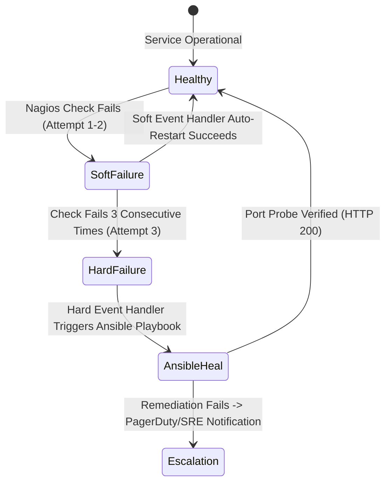

# NexGrad Self-Healing Infrastructure Design

## Overview

The Self-Healing Infrastructure Management Platform enables autonomic failure detection, isolation, and remediation without requiring manual SRE intervention.

## Incident & Remediation Lifecycle

## Detailed Remediation Actions

1. **Soft State Critical (Attempts 1 & 2)**:
   - Nagios detects HTTP timeout, 5xx errors, or dead socket.
   - The event handler (`handle_backend_failure.sh` / `handle_ai_failure.sh`) immediately invokes systemctl restart.
   - 95% of transient issues (e.g., worker pool exhaustion, memory spikes) are resolved in < 5 seconds.

2. **Hard State Critical (Attempt 3)**:
   - When a failure persists, Nagios marks the service in `HARD CRITICAL` state.
   - The event handler triggers the Ansible `self_healing.yml` automated playbook.
   - The playbook purges stale PID locks, clears temporary files, restarts the daemon, runs an integrity health probe, and logs the incident audit trail to `/var/log/nexgrad/self-healing.log`.

